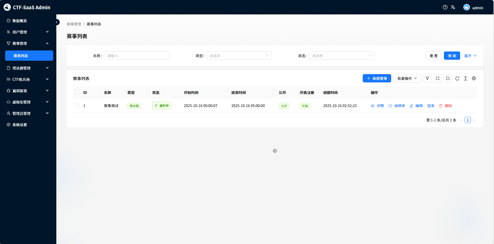
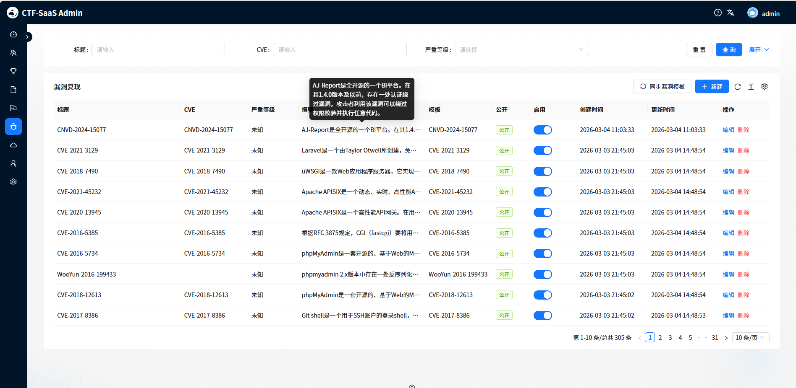

<div align="center">
  
  <h1>CloudCTF</h1>
  <p><strong>面向竞赛、教学与企业内训的私有化 CTF 与漏洞靶场平台</strong></p>
  <p>选手端与管理端内嵌于单一 Go 二进制，支持动态靶机、理论考试与完整赛事运营。</p>

  <p><strong>简体中文</strong> · <a href="README_EN.md">English</a></p>

  <p>
    <a href="https://github.com/hexbay/CloudCTF/releases"></a>
    <a href="https://github.com/hexbay/CloudCTF/actions/workflows/integration-tests.yml"></a>
    <a href="https://github.com/hexbay/CloudCTF/actions/workflows/codeql.yml"></a>
    <a href="https://hexbay.github.io/CloudCTF/"></a>
    <a href="LICENSE"></a>
  </p>

  <p>
    <a href="http://cloud-ctf.lostpeach.cn/"><strong>在线预览</strong></a>
    · <a href="https://hexbay.github.io/CloudCTF/">在线文档</a>
    · <a href="https://github.com/hexbay/CloudCTF/releases">下载版本</a>
    · <a href="https://github.com/hexbay/CloudCTF/issues">问题反馈</a>
  </p>
</div>

---

## 为什么选择 CloudCTF

CloudCTF 将选手门户、管理后台、竞赛服务与靶场管理整合在一个可私有化部署的平台中。默认使用 SQLite，下载单个二进制即可运行；生产环境可切换 MySQL，并接入本机或远程 Docker 主机。

<table>
  <tr>
    <td width="33%" align="center"><br><strong>赛事运营</strong><br><sub>个人赛、团队赛、报名、计分、排行榜与公告</sub></td>
    <td width="33%" align="center"><br><strong>多种题型</strong><br><sub>Web、Pwn、Crypto、Misc、理论题与考试</sub></td>
    <td width="33%" align="center"><br><strong>动态靶场</strong><br><sub>Docker 单容器与多容器模板、自动回收与资源限制</sub></td>
  </tr>
  <tr>
    <td width="33%" align="center"><br><strong>漏洞训练</strong><br><sub>漏洞模板同步、CVE 练习与独立运行环境</sub></td>
    <td width="33%" align="center"><br><strong>权限与审计</strong><br><sub>多角色权限、资源级控制、操作审计与安全策略</sub></td>
    <td width="33%" align="center"><br><strong>数据分析</strong><br><sub>实时成绩、赛事数据、训练记录与运营视图</sub></td>
  </tr>
</table>

### 核心优势

- **一体化交付**：React 前端内嵌进 Go 服务，单二进制即可同时提供选手端和管理端。
- **灵活部署**：支持 Linux AMD64 / ARM64、Docker、SQLite 和 MySQL。
- **完整靶场能力**：管理 Docker 主机、镜像、模板、容器组和运行时生命周期。
- **安全运维**：内置备份、审计、管理员密码恢复，以及基于 GitHub Release 的手动在线更新。
- **开放扩展**：清晰的 API、模块化前后端与完整文档，适合二次开发和私有化定制。

## 界面预览

<table>
  <tr>
    <td width="50%" align="center"><strong>赛事管理</strong></td>
    <td width="50%" align="center"><strong>漏洞训练</strong></td>
  </tr>
  <tr>
    <td></td>
    <td></td>
  </tr>
</table>

## 快速开始

### 下载单二进制（推荐）

从 [GitHub Releases](https://github.com/hexbay/CloudCTF/releases) 下载适合服务器架构的文件：

| 架构 | 程序文件 | 校验文件 |
| --- | --- | --- |
| Linux x86_64 | `cloudctf-linux-amd64` | `cloudctf-linux-amd64.sha256` |
| Linux ARM64 | `cloudctf-linux-arm64` | `cloudctf-linux-arm64.sha256` |

```bash
curl -LO https://github.com/hexbay/CloudCTF/releases/latest/download/cloudctf-linux-amd64
curl -LO https://github.com/hexbay/CloudCTF/releases/latest/download/cloudctf-linux-amd64.sha256
sha256sum -c cloudctf-linux-amd64.sha256
chmod +x cloudctf-linux-amd64
./cloudctf-linux-amd64
```

启动后访问：

| 入口 | 地址 |
| --- | --- |
| 选手端 | `http://<服务器 IP>:8005/` |
| 管理后台 | `http://<服务器 IP>:8005/admin` |
| 健康检查 | `http://<服务器 IP>:8005/healthz` |

> 开发模式会创建演示账号。正式部署请配置生产环境变量，不要继续使用演示密码。

### 使用 Docker

```bash
docker build -t cloudctf:local -f backend/Dockerfile .

docker run -d --name cloudctf --restart unless-stopped \
  -p 8005:8005 \
  -v /var/run/docker.sock:/var/run/docker.sock \
  -v "$PWD/data:/app/data" \
  -v "$PWD/static:/app/static" \
  -e APP_ENV=production \
  -e JWT_SECRET='替换为强随机字符串' \
  -e FIRST_SUPERUSER_PASSWORD='替换为至少12位的强密码' \
  -e ALLOWED_ORIGINS='http://服务器IP:8005' \
  cloudctf:local
```

> Docker Socket 等同于较高的宿主机权限。生产环境应隔离靶场节点，并限制挂载、网络和镜像来源。

### 从源码运行

开发环境需要 **Go 1.26+**、**Node.js 22.12+** 和 npm；动态靶机与完整集成测试还需要 Docker。

```bash
git clone https://github.com/hexbay/CloudCTF.git
cd CloudCTF/frontend
npm ci
npm run build

cd ../backend
go run ./cmd/server
```

## 常用配置

CloudCTF 从环境变量读取配置，也支持通过 `CONFIG_FILE` 指定 `.env` 文件。

| 变量 | 默认值 | 用途 |
| --- | --- | --- |
| `HOST` | `0.0.0.0` | HTTP 监听地址 |
| `PORT` | `8005` | HTTP 监听端口 |
| `APP_ENV` | `development` | 设为 `production` 启用生产安全检查 |
| `DATABASE_URI` | `sqlite://data/cloudctf.db` | SQLite 或 MySQL 数据库连接 |
| `JWT_SECRET` | `change-me` | JWT 密钥；生产环境必须修改 |
| `FIRST_SUPERUSER_USERNAME` | `admin` | 首次创建的超级管理员用户名 |
| `FIRST_SUPERUSER_PASSWORD` | 空 | 生产环境要求至少 12 位 |
| `ALLOWED_ORIGINS` | `*` | 允许的跨域来源；生产环境必须显式配置 |
| `UPDATE_ENABLED` | `true` | 是否启用管理端在线更新入口 |

完整配置、MySQL、systemd 和反向代理示例参见[生产部署文档](https://hexbay.github.io/CloudCTF/guide/production-deploy)。

## 运维速查

### 重置管理员密码

CLI 会直接更新数据库、撤销已有刷新会话，并要求管理员下次登录后修改密码：

```bash
./cloudctf-linux-amd64 reset-admin-password --username admin
```

非交互环境可通过标准输入传入密码：

```bash
printf '%s\n' '新的强密码' | ./cloudctf-linux-amd64 reset-admin-password --username admin --password-stdin
```

### 在线更新

超级管理员进入管理端时会检查最新 GitHub Release；发现新版本后只提示，**不会自动安装**。管理员可在“系统设置 → 系统信息”中查看发布说明并手动确认更新。容器化部署建议通过重新构建或拉取镜像升级。

## 项目结构

```text
CloudCTF/
├── backend/           Go API、业务服务、数据库与嵌入式前端
├── frontend/          React + TypeScript 选手端与管理后台
├── docs/              VitePress 文档站
├── tests/integration/ HTTP 端到端测试
├── deploy/            部署相关文件
└── .github/workflows/ CI、CodeQL、文档和 Release 工作流
```

## 文档导航

| 指南 | 内容 |
| --- | --- |
| [快速开始](https://hexbay.github.io/CloudCTF/guide/quick-start) | 下载、启动与首次访问 |
| [生产部署](https://hexbay.github.io/CloudCTF/guide/production-deploy) | systemd、反向代理、数据库和在线更新 |
| [管理员指南](https://hexbay.github.io/CloudCTF/guide/admin-guide) | 赛事、题目、靶场与系统管理 |
| [技术架构](https://hexbay.github.io/CloudCTF/guide/architecture) | 模块划分、数据流与开发说明 |
| [API 文档](https://hexbay.github.io/CloudCTF/api/overview) | API 入口与认证方式 |

## 参与贡献

欢迎提交 Issue 与 Pull Request。开始前请阅读 [CONTRIBUTING.md](CONTRIBUTING.md)，提交改动前至少运行：

```bash
cd backend && go test ./...
cd ../frontend && npm run build
```

## 安全

请勿通过公开 Issue 披露安全漏洞。请使用 GitHub Security Advisory 私下报告，并阅读 [SECURITY.md](SECURITY.md) 了解支持范围与安全边界。

## 许可证

CloudCTF 基于 [MIT License](LICENSE) 发布。

<div align="center">
  <sub>Built for practical security training and CTF operations.</sub>
</div>
