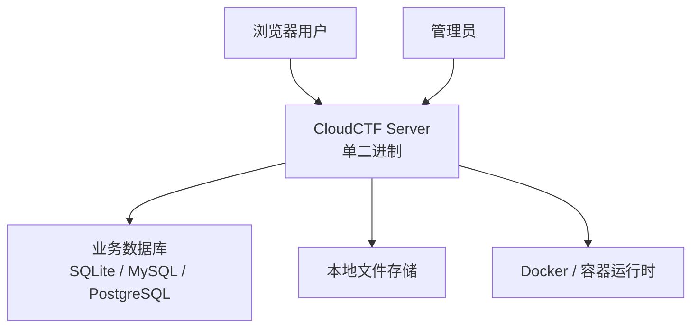
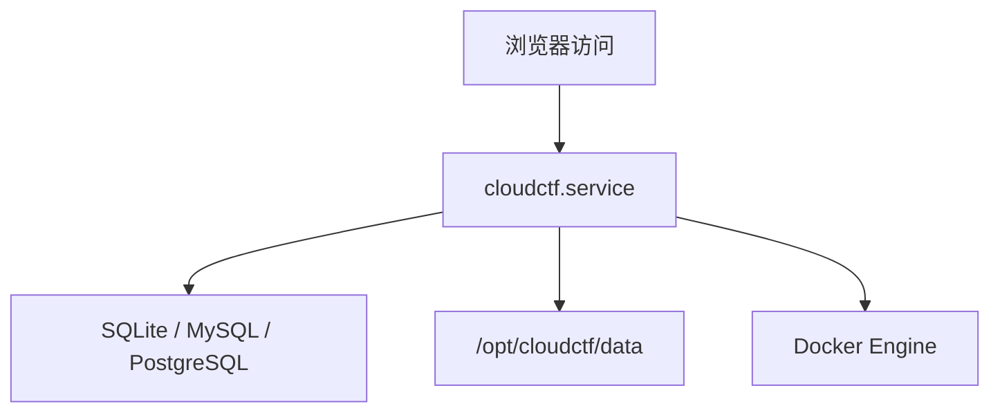

# 技术架构

CloudCTF 当前采用 **Go 后端 + 内嵌前端 + 单二进制交付** 的架构方案，生产环境主推 `systemd` 直接托管服务进程。

## 整体架构



说明：

- **前端已内嵌**：选手端与管理后台静态资源都由 `CloudCTF Server` 直接提供
- **数据库可配置**：默认 SQLite，生产可切换 MySQL 或 PostgreSQL
- **动态靶机运行时独立**：平台本身不依赖 Docker 部署，但动态题目运行仍可依赖 Docker

## 核心组件

### 1. CloudCTF Server

主职责：

- 提供 `/` 与 `/admin` 页面
- 提供 `/api`、`/api-admin`、`/api/public` 接口
- 处理认证、比赛、题目、理论考试、公告、审计、备份等核心业务

特点：

- 单二进制交付
- 内嵌前端资源
- 可直接由 `systemd` 托管

### 2. 数据库

当前通过 `DATABASE_URI` 配置。

支持场景：

- **SQLite**：单机、零依赖、快速启动
- **MySQL**：生产环境推荐
- **PostgreSQL**：使用 PostgreSQL 基础设施的生产环境

## 技术栈

### 后端

| 技术 | 说明 |
|------|------|
| Go | 主服务语言 |
| net/http | HTTP 服务 |
| GORM | ORM 与数据库访问 |
| SQLite / MySQL / PostgreSQL Driver | 可切换数据库 |

### 前端

| 技术 | 说明 |
|------|------|
| React | UI 框架 |
| TypeScript | 类型系统 |
| Vite | 构建工具 |
| Ant Design | 管理后台组件 |

### 运行时与交付

| 技术 | 说明 |
|------|------|
| systemd | 生产环境服务托管 |
| 单二进制 | 主服务交付形式 |
| Docker | 动态靶机与漏洞环境运行时 |

## 路由结构

当前前后端契约如下：

- `GET /`：选手端页面
- `GET /admin`：管理后台页面
- `/api`：选手端 API
- `/api-admin`：管理端 API
- `/api/public`：公共 API

这意味着：

1. 不需要单独部署前端站点
2. 不需要额外配置前端反向代理才能访问管理端
3. 升级时只需要替换服务二进制

## 生产部署架构

### 推荐单机生产架构



适用场景：

- 企业内部竞赛平台
- 培训平台
- 理论考试平台
- 中小规模单机部署

## 文件与数据

生产环境中通常需要持久化这些目录：

- `data/`
- `uploads/`
- `backups/`
- `logs/`

典型部署目录：

```text
/opt/cloudctf/
  bin/
  config/
  data/
  logs/
```

## 为什么要改成单二进制方案

相较旧的容器化主服务部署方式，当前方案有这些优势：

- 部署链路更短
- 前后端版本天然一致
- 升级动作更简单
- 更容易接入已有 Linux 服务器与运维体系
- 对于不需要完整容器编排的平台场景更轻量

## 下一步

- [快速开始](/guide/quick-start)
- [管理员指南](/guide/admin-guide)
- [常见问题](/guide/faq)
